# BetssonEscuadronMCP — validador automático de juegos de casino

**Comprueba solo, en la web real de Betsson, que un juego de casino funciona bien para el jugador**: entra, juega una tirada con dinero real y entrega un informe en verde o rojo, con fotos, de cada cosa que ha comprobado.

Proyecto del equipo EscuadronMCP para el reto de **Betsson** en el **Malackathon 2026** (Universidad de Málaga): *Intelligent Game Validation*.

> **Estado actual:** [`docs/ESTADO.md`](docs/ESTADO.md) · **Cómo es la web por dentro:** [`docs/betsson-es-flujo.md`](docs/betsson-es-flujo.md) · **Para los mentores:** [`mentores/`](mentores/)

---

## En pocas palabras (para quien no ha visto el código)

### Qué problema resuelve
Cuando Betsson incorpora un juego de un proveedor externo (por ejemplo, Pragmatic Play), alguien tiene que comprobar a mano que el juego se ve, que se puede jugar y que **el dinero cuadra**. Es lento, repetitivo y hay cientos de juegos.

### Qué hace
Ejecuta, sin que nadie toque nada, los dos recorridos que pide Betsson en **betsson.es**:

1. **Tirada completada** (cuenta con saldo): juega una tirada y comprueba que el juego giró de verdad, que la apuesta y la moneda son las correctas y que **saldo después = saldo antes − apuesta + premio**, tanto en el juego como en Betsson.
2. **Saldo insuficiente** (cuenta sin saldo): intenta jugar y comprueba que el juego lo impide, que avisa con un mensaje **en español** y que ningún saldo cambia.

### Cómo lo hace: como un jugador, pero con varios testigos
El juego es una "caja negra": lo programa el proveedor y se dibuja como una imagen, sin botones ni textos que un programa pueda leer directamente. Por eso el validador **mira la pantalla como lo haría una persona** (lee los números con reconocimiento de texto y busca los botones por su aspecto).

Y no se fía de una sola fuente: como un auditor, **cada comprobación la confirman hasta cinco "testigos" independientes**:

| Testigo | Qué aporta |
|---|---|
| 👁️ La pantalla del juego | Lo que ve el jugador: crédito, apuesta, premio, mensajes |
| 🎰 El movimiento de los rodillos | Que el juego giró de verdad (pulsar el botón no basta) |
| 💶 El saldo de Betsson | El saldo de la cabecera de la web, antes y después |
| 🌐 El servidor del juego | Lo que el juego registró en su servidor (observado, nunca modificado) |
| 📨 Los mensajes del juego a Betsson | Lo que el juego le comunica a la web: ronda, apuesta, premio, idioma… |

Si todos coinciden → **PASS**. Si alguno contradice lo que ve el jugador → **FAIL por discrepancia**: justo el tipo de fallo de integración que interesa encontrar.

### Qué entrega
Un **informe web** con cada comprobación en verde (PASS) o rojo (FAIL), el motivo en lenguaje claro, lo que dijo cada testigo y las capturas de pantalla que lo demuestran. Se genera en el ordenador o, automáticamente, en GitHub.

### Para los mentores: carpeta [`mentores/`](mentores/)
- **`Informe-del-proyecto.pdf`**: el proyecto explicado (reto, enfoque, arquitectura, seguridad, resultados, costes y limitaciones).
- **`Informe-del-programa.pdf`** y la carpeta **`informe-del-programa/`** (abrir `index.html`): un informe real generado por el programa en betsson.es. El escenario 1 pasa y en el escenario 2 hay un **fallo provocado a propósito** para ver qué ocurre cuando algo falla.

### Cómo se ve un fallo (fallo intencionado)
`run --inject-fault <escenario>` suma 0,01 € al saldo final de Betsson leído **antes de evaluar**, como si Betsson cobrara o abonara mal la tirada. El informe lo anuncia en un recuadro, marca **FAIL** la comprobación del saldo con el motivo ("Lo que ve el jugador lo contradice…") y las capturas muestran el saldo real. También se puede lanzar desde GitHub Actions con la opción `inject_fault`. Nunca se usa en una validación normal.

---

## 💶 Es barato

| Concepto | Coste |
|---|---|
| **Cada ejecución** (juego ya conocido) | **0 € en IA**: todo se procesa en local |
| **Incorporar un juego nuevo** | **≈ 0,001 $** (medido: 0,0006–0,0080 $) |
| Reparar un juego si el proveedor cambia su pantalla | ≈ 0,002 $, solo cuando ocurre |
| La tirada de prueba (apuesta mínima 0,20 €) | ≈ 0,01 € de media (el juego devuelve ~94,5 %) |
| Infraestructura | Gratis: GitHub Actions con un equipo propio en España |
| **Tiempo por ejecución** | **≈ 70 s** los dos escenarios (en paralelo) |
| **Peso del informe** | **< 1 MB** (capturas justas; vídeo solo si se pide) |

Comparado con **15–30 minutos de una persona** por juego nuevo, el coste es despreciable. La inteligencia artificial solo se usa para *aprender* un juego la primera vez; después el validador trabaja solo y sin coste.

## 🧩 Se adapta a cualquier juego y proveedor

- **Nada está "cableado" a un juego.** Cada juego tiene un *perfil* (qué textos tiene su marcador y cómo son sus botones) que una IA aprende en un minuto y que se **comprueba antes de aceptarlo** (por ejemplo, que el crédito leído coincide con el saldo real de Betsson).
- **Demostrado de principio a fin con dos juegos muy distintos** de Pragmatic Play, sin escribir código: *Sweet Bonanza 2500* y *Big Bass Halloween Splash 1000* (botones, colores, disposición y animaciones diferentes). Los dos pasan los dos escenarios; añadir el segundo costó **≈ 0,001 $**.
- **Si el proveedor mueve un botón o cambia un texto**, el validador lo vuelve a encontrar solo; si cambia por completo, la IA lo reaprende una vez y lo deja anotado en el informe.
- **Otro proveedor** = un pequeño archivo de configuración (cómo se llama en el filtro del casino) + aprender su juego. **Otro mercado** (otra web de Betsson) = otro archivo de configuración.

## 🔒 Es seguro

- Las contraseñas nunca se guardan en el código ni aparecen en capturas, vídeos ni informes; un escáner revisa cada evidencia y **retira cualquier archivo que contenga un secreto**.
- Las capturas también se leen con OCR por si mostraran una credencial, y el informe final se limpia y se audita antes de publicarse.
- Protección del dinero: siempre la apuesta mínima (comprobada en pantalla), un tope máximo, **nunca repite una tirada** y **no gira si la cuenta no es la esperada** (la cuenta "sin saldo" con fondos, o la "con saldo" sin ellos).

---

## Cómo funciona (vista general)

```mermaid
flowchart LR
    A[Abrir navegador] --> B[Entrar en betsson.es<br/>e iniciar sesión]
    B --> C[Leer saldo de Betsson]
    C --> D[Casino → Filtros →<br/>Pragmatic Play → juego]
    D --> E[Sesión de juego<br/>obligatoria en España]
    E --> F[Esperar al juego y<br/>poner la apuesta mínima]
    F --> G[Una tirada<br/>observando 5 testigos]
    G --> H[Leer saldos finales]
    H --> I[Informe PASS/FAIL<br/>con evidencias]
```



## Glosario

| Término | Significado |
|---|---|
| **Testigo** | Una fuente independiente que confirma (o contradice) un hecho |
| **Perfil** | Lo que el validador sabe de un juego concreto: sus etiquetas y el aspecto de sus botones |
| **OCR** | Reconocimiento de texto en imágenes: así se leen los números de la pantalla del juego |
| **Real Play** | Jugar con dinero real (las cuentas de prueba las proporciona Betsson) |
| **iframe / canvas** | La "ventana dentro de la web" donde el proveedor dibuja su juego como una imagen |
| **postMessage** | Los mensajes que el juego envía a la web de Betsson por dentro del navegador |
| **Runner** | El ordenador que ejecuta las pruebas automáticas de GitHub (debe estar en España) |

---

## Para el equipo técnico

### Uso

Requisitos: [uv](https://docs.astral.sh/uv/) (instala Python 3.13 por sí solo) y Google Chrome.

```bash
uv sync
cp .env.example .env          # y rellena las credenciales (nunca se suben al repositorio)

uv run python -m betsson_validator run                       # ambos escenarios (en paralelo), juego por defecto
uv run python -m betsson_validator run --game big-bass-halloween-splash-1000
uv run python -m betsson_validator run --video               # además, grabar vídeo (informe más pesado)
uv run python -m betsson_validator run --inject-fault insufficient_balance  # demostración de un FAIL
uv run python -m betsson_validator learn --game <slug>       # incorporar un juego nuevo (no gira)
```

El informe queda en `reports/<fecha>/index.html` (más `report.json` y las evidencias de cada escenario).

### Decisiones de arquitectura
- [001 — Testigos independientes con perfiles aprendidos](docs/decisiones/001-enfoque-testigos-y-perfiles.md)
- [002 — Pantalla readaptable y coste](docs/decisiones/002-perfiles-aprendidos-y-coste.md)
- [003 — Testigo de eventos del juego (postMessage)](docs/decisiones/003-testigo-eventos-del-juego.md)

### Más allá de lo pedido

| Aportación | Por qué importa a Betsson | Dónde verlo |
|---|---|---|
| **Cinco testigos de tres capas** (pantalla, red, navegador) con regla de discrepancia | Detecta fallos de integración: el jugador ve una cosa y el sistema registra otra | Columna "Testigos" del informe |
| **Canal `postMessage` juego → casino** como testigo | Valida con los datos que el proveedor comunica a Betsson | `eventos_del_juego.json` en cada escenario |
| **Pantalla readaptable** con perfiles aprendidos por IA | Sigue funcionando si el proveedor cambia la interfaz; un juego nuevo cuesta céntimos | `tests/unit/test_screen_model.py`, `profiles/` |
| **Coste de IA casi nulo y medido** | Las ejecuciones no llaman a la IA; cada llamada registra tokens y coste | Salida de `learn`, notas del informe |
| **Seguridad de evidencias** | Credenciales difuminadas, traza limpiada, escáner de secretos | `src/betsson_validator/security.py` |
| **Salvaguardas de dinero real** | Apuesta mínima comprobada, tope, condiciones previas por escenario, sin repetir tiradas, botones ambiguos rechazados | `scenarios/preconditions.py`, `game/player.py` |
| **Fallo intencionado de demostración** | Enseña cómo se detecta y documenta un fallo de saldo, sin tocar la web | `scenarios/faults.py`, carpeta `mentores/` |

### Calidad

```bash
uv run ruff format . && uv run ruff check .   # formato y lint
uv run mypy src tests                         # tipado estricto
uv run pytest -m "not e2e"                    # tests (con capturas reales y cambios de interfaz simulados)
```

### GitHub Actions
- **CI** (`.github/workflows/ci.yml`): formato, lint, tipos y tests en cada push.
- **Validación** (`.github/workflows/validate.yml`): ejecuta ambos escenarios por mercado y publica el informe como artefacto y como resumen. Se lanza a mano (*Run workflow*) porque juega con dinero real.
  - betsson.es **solo responde desde España**: se ejecuta en un **runner propio con IP española**, elegido con la variable `VALIDATION_RUNS_ON` (hoy `["self-hosted","betsson-es"]`). En producción, una máquina x86 en Oracle Cloud Madrid.
  - Credenciales en *Settings → Secrets and variables → Actions* con los nombres de `.env.example`.

### Estructura

```
config/markets/          Mercado: URL, idioma, divisa, textos de la web, variables de credenciales
config/providers/        Proveedor: chip del filtro, juego por defecto, tope de apuesta, testigos disponibles
profiles/                Perfiles aprendidos por juego (etiquetas y posiciones del HUD + imágenes de controles)
src/betsson_validator/
  casino/                Web de Betsson: cookies, login, saldo, filtro, sesión de juego, lanzamiento
  game/                  Jugar mirando la pantalla (genérico) y grabar los eventos del juego
  perception/            OCR, búsqueda por imagen, movimiento, IA de visión
  providers/             Registro de testigos por proveedor (pragmatic/: red y eventos de Pragmatic Play)
  scenarios/             Comprobaciones oficiales, condiciones previas al giro y fallo de demostración
  domain/                Dinero, regla del veredicto, comprobaciones (lógica pura)
  report/                Informe HTML/JSON y resumen Markdown
docs/                    Estado, decisiones (ADR), flujo real de betsson.es, documentación del reto
mentores/                Informe del proyecto (PDF) e informe real generado por el programa
```
