# BetssonEscuadronMCP — validador automático de juegos de casino

**Comprueba solo, en la web real de Betsson, que un juego de casino funciona bien para el jugador**: entra, juega una tirada con dinero real y entrega un informe en verde o rojo, con capturas, de cada cosa que ha comprobado.

Proyecto del equipo EscuadronMCP para el reto de **Betsson** en el **Malackathon 2026** (Universidad de Málaga): *Intelligent Game Validation*.

> **Para los mentores:** carpeta [`mentores/`](mentores/) (informe del proyecto en PDF e informes reales del programa) · **Estado:** [`docs/ESTADO.md`](docs/ESTADO.md) · **Cómo es la web por dentro:** [`docs/betsson-es-flujo.md`](docs/betsson-es-flujo.md)

---

## 1. Cómo usarlo: generar los informes

### Requisitos
- Un ordenador con **conexión desde España**: betsson.es no responde desde otros países.
- **Google Chrome** instalado.
- [**uv**](https://docs.astral.sh/uv/getting-started/installation/), que instala por sí solo Python 3.13 y las dependencias exactas.
- Las **dos cuentas de prueba** que da Betsson: una con saldo y otra sin saldo.

### Instalación (una vez)

```bash
git clone https://github.com/EscuadronMCP/BetssonEscuadronMCP.git
cd BetssonEscuadronMCP
uv sync
cp .env.example .env      # y escribe en .env el correo y la contraseña de las dos cuentas
```

El archivo `.env` nunca se sube al repositorio. La clave de IA (`ANTHROPIC_API_KEY`) es opcional: solo hace falta para aprender un juego nuevo.

### Generar un informe

```bash
uv run python -m betsson_validator run
```

Sin que nadie toque nada, abre un Chrome oculto, entra en betsson.es, inicia sesión, va a Casino → Pragmatic Play, abre el juego, ejecuta **los dos escenarios en paralelo** (≈ 70–90 s) y escribe el informe:

```
Informe: reports/<fecha>-<proceso>-run/index.html      ← ábrelo con el navegador
Datos:   reports/<fecha>-<proceso>-run/report.json
```

El programa termina con código **0 si todo es PASS** y **1 si algo es FAIL** (útil en automatización).

| Quiero… | Comando |
|---|---|
| Los dos escenarios con el juego por defecto (Sweet Bonanza 2500) | `uv run python -m betsson_validator run` |
| Otro juego ya aprendido (p. ej. Big Bass Halloween Splash 1000) | `uv run python -m betsson_validator run --game big-bass-halloween-splash-1000` |
| **Ver cómo se ve un FALLO** (provocado a propósito, sin apostar más) | `uv run python -m betsson_validator run --inject-fault insufficient_balance` |
| Solo un escenario | `… run --scenario completed_spin` o `… run --scenario insufficient_balance` |
| Ver el navegador mientras trabaja | `… run --headed` |
| Grabar también un vídeo | `… run --video` |
| Medir qué expone el juego a la accesibilidad (diagnóstico) | `… run --ax-probe` |
| Elegir la carpeta del informe | `… run --out reports/mi-prueba` |
| Escenarios uno tras otro, sin paralelo | `… run --sequential` |
| Incorporar un juego nuevo (usa IA, **no gira**) | `uv run python -m betsson_validator learn --game <slug>` |

### Desde GitHub (sin instalar nada)
En **Actions → «Validación de juegos» → Run workflow**, elige el escenario y, si quieres ver un fallo, `inject_fault`. Al terminar, el informe está en el artefacto **`informe-es`** y el resumen en la propia ejecución. Requiere un runner con IP española (variable `VALIDATION_RUNS_ON`) y las credenciales como *Secrets* con los nombres de `.env.example`.

### Antes de ejecutar, ten en cuenta
- **Una sola ejecución a la vez con las mismas cuentas.** Dos sesiones simultáneas se pisan: la web cierra una («Sesión expirada», «¡Acceda a su cuenta!») o la otra gasta saldo durante la tirada, y el validador lo marca como discrepancia. En un mismo ordenador lo impide un cerrojo; entre ordenadores hay que coordinarse.
- El escenario 1 **apuesta 0,20 € reales** (la apuesta mínima, comprobada en pantalla).
- Sin `ANTHROPIC_API_KEY` funciona igual con los perfiles ya aprendidos; solo pierde la reparación automática de un perfil.

### Qué muestra el informe
- **Panel de resumen:** resultado global, comprobaciones superadas, duración, uso de IA y versión del código (SHA).
- **Por cada escenario:**
  - una frase en lenguaje llano con lo que pasó;
  - las capturas antes, durante y después;
  - una **cuadrícula comprobaciones × testigos**, con lo que dijo cada uno al pasar el ratón;
  - los **valores que dio cada testigo** (saldos, apuesta, premio, divisa e idioma), con las discrepancias marcadas;
  - la **regla del dinero** como ecuación y el mensaje de saldo insuficiente destacado;
  - la **gráfica del movimiento** de los rodillos, la cronología de la ejecución y los eventos del juego;
  - el detalle de cada comprobación y los enlaces a las evidencias: traza, eventos, tráfico sin tokens y resumen en JSON.
- **Si algo falla:** el motivo y una captura de la pantalla en ese momento.

---

## 2. Qué hace (para quien no ha visto el código)

### Qué problema resuelve
Cuando Betsson incorpora un juego de un proveedor externo (por ejemplo, Pragmatic Play), alguien tiene que comprobar a mano que el juego se ve, que se puede jugar y que **el dinero cuadra**. Es repetitivo y hay cientos de juegos.

### Los dos recorridos del reto, en betsson.es
1. **Tirada completada** (cuenta con saldo): juega una tirada y comprueba que el juego giró de verdad, que la apuesta y la divisa son las mostradas y que **saldo después = saldo antes − apuesta + premio**, en el juego y en Betsson.
2. **Saldo insuficiente** (cuenta sin saldo): intenta jugar y comprueba que el juego lo impide, que avisa con un mensaje **en español** y que ningún saldo cambia.

### Como un jugador, pero con varios testigos
El juego se dibuja como una imagen dentro de la web (un *canvas*), sin botones ni textos que un programa pueda leer. Lo hemos medido: su árbol de accesibilidad está vacío. Por eso el validador **mira la pantalla como una persona**: lee los números con reconocimiento de texto y busca los botones por su aspecto.

Y no se fía de una sola fuente: **cada comprobación la contrastan hasta cinco testigos**.

| Testigo | Qué aporta |
|---|---|
| 👁️ La pantalla del juego | Lo que ve el jugador: crédito, apuesta, premio, mensajes |
| 🎰 El movimiento de los rodillos | Que el juego giró de verdad (pulsar el botón no basta) |
| 💶 El saldo de Betsson | El saldo de la cabecera de la web, antes y después |
| 🌐 El servidor del juego | Lo que el juego registró en su servidor (observado, nunca modificado) |
| 📨 Los mensajes del juego a Betsson | Lo que el juego comunica a la web: ronda, apuesta, premio, idioma… |

Lo que ve el jugador es obligatorio para un **PASS**. Si un testigo lo contradice, el resultado es **FAIL por discrepancia**: justo el fallo de integración que interesa encontrar. Los testigos no son totalmente independientes entre sí (pantalla y movimiento salen de las mismas capturas), por eso lo que ve el jugador manda y el resto corrobora.

---

## 3. Coste, adaptación y seguridad

### 💶 Es barato (medido el 15/10/2026)

| Concepto | Coste |
|---|---|
| **Cada ejecución** de un juego ya aprendido | **0 llamadas a la IA**: todo se procesa en local |
| **Incorporar un juego nuevo** (`learn`) | ≈ 0,001–0,008 $ (medido con Claude Haiku/Sonnet) |
| Reparar un perfil si el proveedor cambia su pantalla | ≈ 0,002 $, solo si ocurre, y queda anotado en el informe |
| Dinero apostado por ejecución | 0,20 € (escenario 1). La pérdida **esperada** es ≈ 0,01 € (el juego devuelve ~94,5 %), pero una tirada concreta puede perder los 0,20 € |
| Infraestructura | Gratis: GitHub Actions con un equipo propio en España |
| **Tiempo por ejecución** | ≈ 70–90 s los dos escenarios en paralelo (medido en este equipo) |
| **Peso del informe** | < 1 MB sin vídeo (5 capturas JPEG por escenario) |

Frente a la revisión manual de un juego nuevo (estimamos 15–30 minutos de una persona), el coste es despreciable.

### 🧩 Se adapta a juegos y proveedores
- **Nada está cableado a un juego.** Cada juego tiene un *perfil* (textos de su marcador y aspecto de sus botones) que una IA aprende en un minuto. El perfil **se valida antes de aceptarlo**: el crédito leído debe coincidir con el saldo real de Betsson y «−» debe bajar la apuesta. Una propuesta de la IA que no cuadra se rechaza.
- **Demostrado de principio a fin con dos juegos muy distintos** de Pragmatic Play, sin escribir código: *Sweet Bonanza 2500* y *Big Bass Halloween Splash 1000*.
- **Si el proveedor mueve un botón o cambia un texto**, se reencuentra solo. Si cambia por completo, se reaprende una vez y queda anotado.
- **Otro proveedor** necesita su archivo de configuración y aprender sus juegos. Si cambia la apuesta de otra forma o tiene su propio tráfico y eventos, necesita además un adaptador registrado en `providers/registry.py`. Play'n GO está configurado, pero **no está demostrado**: su apuesta se cambia desde un panel aparte. **Otro mercado** solo necesita otro archivo de configuración.

### 🔒 Seguridad
- Las credenciales solo están en `.env` o en GitHub Secrets. Los campos de login se difuminan en origen.
- Un escáner revisa cada evidencia y retira cualquier archivo con un secreto, indicándolo en el informe:
  - **texto**, incluidas las formas escapadas en URL, JSON y HTML;
  - **trazas comprimidas**;
  - **capturas, leídas con OCR**.
- El informe final y el resumen de GitHub también se limpian. El vídeo opcional no se escanea, por eso no se graba por defecto.
- **Dinero real:** la apuesta mínima se comprueba en pantalla y hay un tope máximo. La divisa debe verse en el juego, y nunca se repite una tirada. **No se gira** si la cuenta no es la esperada: ni con la cuenta «sin saldo» si tiene fondos, ni con la «con saldo» si no los tiene.

---

## 4. Cómo funciona (vista general)

```mermaid
flowchart LR
    A[Abrir navegador] --> B[Entrar en betsson.es<br/>e iniciar sesión]
    B --> C[Leer saldo de Betsson]
    C --> D[Casino → Filtros →<br/>Pragmatic Play → juego]
    D --> E[Sesión de juego<br/>obligatoria en España]
    E --> F[Esperar al juego y<br/>poner la apuesta mínima]
    F --> G[Condiciones previas<br/>y una tirada observada]
    G --> H[Esperar al cierre<br/>de la ronda y leer saldos]
    H --> I[Informe PASS/FAIL<br/>con evidencias]
```



### Glosario

| Término | Significado |
|---|---|
| **Testigo** | Una fuente que confirma (o contradice) un hecho |
| **Perfil** | Lo que el validador sabe de un juego concreto: sus etiquetas y el aspecto de sus botones |
| **OCR** | Reconocimiento de texto en imágenes: así se leen los números de la pantalla del juego |
| **Real Play** | Jugar con dinero real (las cuentas de prueba las proporciona Betsson) |
| **iframe / canvas** | La "ventana dentro de la web" donde el proveedor dibuja su juego como una imagen |
| **postMessage** | Los mensajes que el juego envía a la web de Betsson por dentro del navegador |
| **Runner** | El ordenador que ejecuta las pruebas automáticas de GitHub (debe estar en España) |

---

## 5. Para el equipo técnico

Se ejecuta **desde el repositorio** con `uv` (instrucciones de la sección 1). No se distribuye como paquete instalable: la configuración (`config/`) y los perfiles (`profiles/`) viven en el repositorio.

### Decisiones de arquitectura
- [001 — Testigos independientes con perfiles aprendidos](docs/decisiones/001-enfoque-testigos-y-perfiles.md)
- [002 — Pantalla readaptable y coste](docs/decisiones/002-perfiles-aprendidos-y-coste.md)
- [003 — Testigo de eventos del juego (postMessage)](docs/decisiones/003-testigo-eventos-del-juego.md)

### Más allá de lo pedido

| Aportación | Por qué importa a Betsson | Dónde verlo |
|---|---|---|
| **Cinco testigos de tres capas** (pantalla, red, navegador) con regla de discrepancia | Detecta fallos de integración: el jugador ve una cosa y el sistema registra otra | Cuadrícula de testigos del informe |
| **Canal `postMessage` juego → casino** atribuido al marco del juego | Valida con los datos que el proveedor comunica a Betsson | `eventos_del_juego.json` en cada escenario |
| **Pantalla readaptable** con perfiles aprendidos y validados | Sigue funcionando si el proveedor cambia la interfaz | `tests/unit/test_screen_model.py`, `profiles/` |
| **Informe gráfico** con valores por testigo, ecuación del dinero, gráfica del giro y cronología | Se entiende sin conocer el proyecto y deja ver cada dato | `report/` y carpeta `mentores/` |
| **Seguridad de evidencias** | Escáner de texto, zip y OCR de capturas; informe final auditado | `src/betsson_validator/security.py` |
| **Salvaguardas de dinero real** | Condiciones previas por escenario, cerrojo por cuenta, sin repetir tiradas | `scenarios/preconditions.py`, `locks.py` |
| **Fallo intencionado de demostración** | Enseña cómo se detecta y documenta un fallo, sin apostar más | `scenarios/faults.py` |
| **Sonda de accesibilidad** (`--ax-probe`) | Mide si el juego expone semántica (resultado: árbol vacío) | `game/accessibility.py` |

### Calidad

```bash
uv run ruff format . && uv run ruff check .   # formato y lint
uv run mypy src tests                         # tipado estricto
uv run pytest -m "not e2e"                    # tests (capturas y tráfico reales, cambios de interfaz simulados)
```

### GitHub Actions
- **CI** (`.github/workflows/ci.yml`): formato, lint, tipos y tests en cada push.
- **Validación** (`.github/workflows/validate.yml`): ejecuta los escenarios por mercado y publica el informe como artefacto y como resumen. Se lanza a mano porque juega con dinero real.
  - betsson.es **solo responde desde España**, así que se ejecuta en un **runner propio con IP española**, elegido con la variable `VALIDATION_RUNS_ON` (hoy `["self-hosted","betsson-es"]`). En producción sería una máquina x86 en Oracle Cloud Madrid.

### Estructura

```
config/markets/          Mercado: URL, idioma, divisa, textos de la web, variables de credenciales
config/providers/        Proveedor: chip del filtro, juego por defecto, tope de apuesta, testigos
profiles/                Perfiles aprendidos por juego (etiquetas y posiciones del HUD + imágenes)
src/betsson_validator/
  casino/                Web de Betsson: cookies, login, saldo, filtro, sesión de juego, lanzamiento
  game/                  Jugar mirando la pantalla, eventos del juego y sonda de accesibilidad
  perception/            OCR, búsqueda por imagen, movimiento, IA de visión
  providers/             Registro de testigos por proveedor (pragmatic/: red y eventos)
  scenarios/             Comprobaciones, condiciones previas y fallo de demostración
  domain/                Dinero, regla del veredicto, comprobaciones (lógica pura)
  report/                Informe HTML (gráfico) y JSON, resumen Markdown
docs/                    Estado, decisiones (ADR), flujo real de betsson.es, documentación del reto
mentores/                Informe del proyecto (PDF) e informes reales generados por el programa
```
